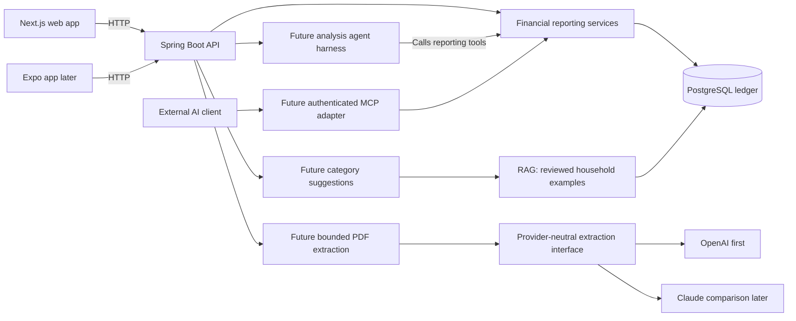

# AI technology in Expense Tracker

This document explains where harness, RAG, and MCP fit into the project. The
planned frontend is Next.js with TypeScript and the App Router; Java Spring Boot
is the selected backend for shared APIs and financial services. Expo can use
the same API later. The project is also a long-term AI engineering learning
project: each experiment
needs a working feature, a simpler baseline, measured results, and a write-up.

Use [next-move.md](next-move.md) for current implementation and verification,
and [roadmap.md](roadmap.md) for the phase sequence. This document describes
the intended roles of the technologies, not evidence that they are running.
Production services and the first offline evaluation runner use Java; neither
Spring AI nor an MCP dependency is required for the first extraction experiment.

## First experiment: PDF extraction and evaluation

Start with PDF statements, OpenAI first behind a provider-neutral extraction
interface, and a deterministic CSV baseline where a comparable export exists.
Receipts come later. The first issuer/layout is still unselected; Capital One,
Chase, and Amex are targets, not implemented parsers.

Test the contract first with synthetic PDFs/CSVs, a fake PDF provider, and a
standalone Java scorer that writes JSONL. Fake results exercise validation and
evaluation mechanics; they do not establish live model extraction quality.

The first loop is PDF input -> schema-constrained extraction -> code validation
and staging -> review/correction -> versioned labels -> evaluation. This is a
bounded workflow, not an agent loop. Preserve source descriptions and page/row
references, allow unknown fields, and block invalid required values from ledger
confirmation. Code normalizes money and dates and calculates totals. Structured
Outputs constrain shape, not factual accuracy; handle refusals, incomplete
responses, and semantic errors. [OpenAI file inputs](https://developers.openai.com/api/docs/guides/file-inputs),
[Structured Outputs](https://developers.openai.com/api/docs/guides/structured-outputs).

Trace and evaluate from the first call. Default traces record run and version
identifiers, token usage, cost estimate and pricing basis (or unknown cost), latency, retry/error
codes, and validation results. Keep statements and prediction records in private
application storage, never ordinary logs or Git. Optional raw prompt/output
trace payloads need explicit opt-in, private access-controlled storage, and
retention/deletion behavior. Provider calls need processing consent and bounded
input, output, attempts, time, and cost.

Keep immutable predictions separate from versioned review labels. Record who
reviewed the row and distinguish an accepted suggestion from a label verified
against source evidence. All records and later retrieval carry the authorized
household context. Split by source document group so pages, duplicate exports,
and paired CSV/PDF representations cannot cross splits. Hold test labels out of
prompt tuning, few-shot examples, retrieval, and training.

Measure row precision/recall, exact amount/date/flow/currency accuracy, missing
and hallucinated rows, review corrections, document failures, retries, cost per
document, and latency. Include prompt-injection fixtures from the start. Commit
synthetic fixtures and results only; keep real data private. See
[imports.md](imports.md) for the contract and evaluation details and
[OpenAI evals](https://developers.openai.com/api/docs/guides/evals) for evaluation
concepts. Compare Claude later on the same held-out set rather than choosing a
provider from impressions.

## Where each concept belongs

| Concept | Role | Proposed use in this project |
| --- | --- | --- |
| Harness | Coordinates model calls, tool execution, context, and stopping conditions | Run an analysis agent that investigates a spending question using authorized reporting tools |
| RAG | Retrieves relevant information and supplies it as context for a model response | Retrieve authorized household classifications to help suggest a category for an unfamiliar transaction |
| MCP | Provides a standard interface through which compatible AI clients discover and call tools | Let an external AI client request authorized spending reports and supporting transactions |

These concepts can work together, but each addresses a separate need. A model
can use directly registered functions without MCP, and a categorization request
can use RAG without a multi-step agent loop. [OpenAI agent runtimes](https://developers.openai.com/api/docs/guides/agents),
[RAG explanation](https://developers.openai.com/api/docs/guides/optimizing-llm-accuracy),
[MCP connections](https://developers.openai.com/api/docs/guides/agents-api/tools/mcp).

## Harness: development and application runtime

While we build the project, the coding tool supplies a development harness that
manages the coding agent's execution environment and tools. AGENTS.md and
CLAUDE.md provide project instructions to that environment; the files themselves
are not a harness.

The application would have its own harness when we add a spending-analysis
agent. For example, a user asks:

> Why did my dining spending increase last month?

The harness would send the question and available tools to the model, execute
the model's selected tool calls, return their results, and continue until the
agent has an answer or reaches a configured limit. It would manage step limits,
timeouts, usage limits, failures, and sanitized execution traces.

For learning, build a small handwritten tool loop first, then compare an SDK
implementation against the same tasks. The backend supplies household
authorization, reporting functions, and application state in either version.
Measure task success, invalid calls, unsupported claims, cost, and latency;
demonstrate that step, time, and cost limits stop runs.
[OpenAI agent runtimes](https://developers.openai.com/api/docs/guides/agents).

Ordinary statement processing can remain a bounded workflow: parse, normalize,
validate, stage, and review. A background job queue alone is not an agent harness.

## RAG: personalized category suggestions

RAG means Retrieval-Augmented Generation: retrieve relevant information, add it
to the model's context, and generate an answer using that context.
[OpenAI RAG explanation](https://developers.openai.com/api/docs/guides/optimizing-llm-accuracy).

For an unfamiliar merchant description, the planned flow is:

1. Look for an explicitly saved household rule or an approved merchant match.
2. If neither resolves the category, retrieve similar reviewed examples from
   the authorized household's transaction history.
3. Supply the transaction, allowed categories, and retrieved examples to the
   model.
4. Validate the proposed category and show ambiguous results for user review.

For example, a user may have classified several similar restaurant descriptions
as Dining. Those approved examples can inform a suggestion for a new description.
The model still cannot infer the items inside a purchase from a merchant name.

Applying a fixed merchant rule directly is ordinary rule-based classification.
It becomes RAG when we retrieve examples and supply them to a model for
generation. Start with database retrieval; add semantic search only if simpler
matching is inadequate. A vector database is not required for this initial plan.

Verify identity, active household membership, and the requested role permission
before retrieval and before sending context to the model. A client-supplied
household ID never establishes access. Corrections change future behavior
through explicitly saved rules or eligible retrieved examples; they do not
automatically train or fine-tune a model. Keep held-out evaluation labels out of
retrieval, and track whether examples were verified or merely accepted.

## MCP: access from external AI clients

An MCP server publishes tools and their input definitions so a compatible AI
client can discover and call them. [OpenAI MCP connections](https://developers.openai.com/api/docs/guides/agents-api/tools/mcp).

Our proposed server would expose read-only tools such as:

| Proposed tool | Result |
| --- | --- |
| `get_monthly_spending` | Calculated monthly totals with coverage information |
| `compare_spending` | Category and merchant contributions to a spending change |
| `list_supporting_transactions` | Authorized transactions behind a report |

For example, a connected and authenticated Codex or Claude client could ask our
server to compare two months, then explain the returned facts. The MCP adapter
would call the same backend services used by the web app. Every call must verify
identity, current household membership, role permission, and access to the
requested accounts and records. Revoked members lose access to tools and traces
as well as the ledger.

The Next.js frontend communicates with Spring Boot through the ordinary HTTP API.
MCP is an additional interface for AI clients; it is not required for uploads,
review screens, dashboards, or the internal agent's direct function calls.

## Next.js and Spring Boot responsibilities

| Layer | Responsibility |
| --- | --- |
| Next.js + TypeScript | Upload, review, transaction lists, dashboards, and the spending-question interface |
| Spring Boot API | Spring Security sessions/CSRF, household membership and role checks, application services, category rules, and exact financial calculations |
| Java import worker | Bounded extraction and normalization, provider adapters, staging, and private prediction/label records; reuses the backend's authorization and services |
| Future analysis agent | Select authorized tools and explain their returned facts |
| PostgreSQL | Store the intended public product's household-scoped ledger and processing state |

Next.js can forward requests to an existing backend where useful. Keep the
financial logic in the Java backend so web, mobile, and future MCP tools share it.
[Next.js backend-for-frontend guide](https://nextjs.org/docs/app/guides/backend-for-frontend).

The following diagram shows the intended integrations, not currently running
services:

## Example: explain a spending change

1. A user asks a question in Next.js.
2. Spring Boot verifies the session, active household membership, role permission,
   and requested accounts' household scope.
3. The future harness lets the model call `compare_spending` and, if needed,
   `list_supporting_transactions`.
4. Backend code calculates the amounts from confirmed expenses and refunds,
   returns supporting transaction IDs, and flags incomplete statement coverage.
5. The model explains those facts; Next.js displays the answer and source links.

RAG is useful if the response needs relevant approved examples or user notes.
It is not needed to compute the monthly totals. MCP would allow an external
client to reach the same authorized reporting tools.

Implement category and merchant contributions as deterministic Java calculations
using [the reporting contract](reporting-contract.md) and its synthetic acceptance
cases. An agent would add flexible investigation and natural-language interaction
around that reporting foundation.

AI suggests labels and explains facts; code calculates money. Preserve source
references, require explicit approval to create category rules, and keep
uncertain results reviewable. Before external model processing, obtain user
consent, minimize transmitted fields, and configure usage limits.

See [architecture.md](architecture.md) for system boundaries,
[imports.md](imports.md) for the import workflow, and [roadmap.md](roadmap.md)
for implementation milestones.
