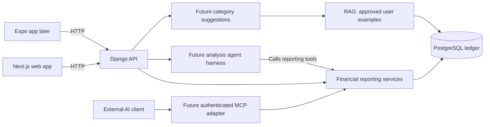

# AI technology in Expense Tracker

This document explains where harness, RAG, and MCP fit into the project. The
planned frontend is Next.js with TypeScript and the App Router; Django provides
the shared API and financial services. Expo can use the same API later.

## Current status

The repository contains ledger models, a health endpoint, and a deterministic
spending-change prototype. The prototype calculates amounts using code and
synthetic transactions; it does not call an AI model.

The web client, statement imports, model classification, app agent harness,
retrieval, and MCP server are planned. Coding-agent guidance already exists in
[AGENTS.md](../AGENTS.md) and [CLAUDE.md](../CLAUDE.md).

## Where each concept belongs

| Concept | Role | Proposed use in this project |
| --- | --- | --- |
| Harness | Coordinates model calls, tool execution, context, and stopping conditions | Run an analysis agent that investigates a spending question using authorized reporting tools |
| RAG | Retrieves relevant information and supplies it as context for a model response | Retrieve the current user's approved classifications to help suggest a category for an unfamiliar transaction |
| MCP | Provides a standard interface through which compatible AI clients discover and call tools | Let an external AI client request authorized spending reports and supporting transactions |

These concepts can work together, but each addresses a separate need. A model
can use directly registered functions without MCP, and a categorization request
can use RAG without a multi-step agent loop. [OpenAI agent runtimes](https://developers.openai.com/api/docs/guides/agents),
[RAG explanation](https://developers.openai.com/api/docs/guides/optimizing-llm-accuracy),
[MCP connections](https://developers.openai.com/api/docs/guides/agents-api/tools/mcp).

## Harness: development and application runtime

While we build the project, the coding tool supplies a development harness that
manages the coding agent's execution environment and tools. AGENTS.md and
CLAUDE.md provide project instructions to that environment; the files themselves
are not a harness.

The application would have its own harness when we add a spending-analysis
agent. For example, a user asks:

> Why did my dining spending increase last month?

The harness would send the question and available tools to the model, execute
the model's selected tool calls, return their results, and continue until the
agent has an answer or reaches a configured limit. It would manage step limits,
timeouts, usage limits, failures, and sanitized execution traces.

An existing agent SDK is one implementation option. Its runner can handle the
agent loop while our backend supplies authorization, reporting functions, and
application state. [OpenAI agent runtimes](https://developers.openai.com/api/docs/guides/agents).

Ordinary statement processing can remain a bounded workflow: parse, normalize,
validate, stage, and review. A background job queue alone is not an agent harness.

## RAG: personalized category suggestions

RAG means Retrieval-Augmented Generation: retrieve relevant information, add it
to the model's context, and generate an answer using that context.
[OpenAI RAG explanation](https://developers.openai.com/api/docs/guides/optimizing-llm-accuracy).

For an unfamiliar merchant description, the planned flow is:

1. Look for an explicit user rule or an approved merchant match.
2. If neither resolves the category, retrieve similar approved examples from
   the current user's transaction history.
3. Supply the transaction, allowed categories, and retrieved examples to the
   model.
4. Validate the proposed category and show ambiguous results for user review.

For example, a user may have classified several similar restaurant descriptions
as Dining. Those approved examples can inform a suggestion for a new description.
The model still cannot infer the items inside a purchase from a merchant name.

Applying a fixed merchant rule directly is ordinary rule-based classification.
It becomes RAG when we retrieve examples and supply them to a model for
generation. Start with database retrieval; add semantic search only if simpler
matching is inadequate. A vector database is not required for this initial plan.

Retrieve within the authenticated user's scope before sending context to the
model. Corrections change future behavior through saved rules or retrieved
examples; they do not automatically train or fine-tune a model.

## MCP: access from external AI clients

An MCP server publishes tools and their input definitions so a compatible AI
client can discover and call them. [OpenAI MCP connections](https://developers.openai.com/api/docs/guides/agents-api/tools/mcp).

Our proposed server would expose read-only tools such as:

| Proposed tool | Result |
| --- | --- |
| `get_monthly_spending` | Calculated monthly totals with coverage information |
| `compare_spending` | Category and merchant contributions to a spending change |
| `list_supporting_transactions` | Authorized transactions behind a report |

For example, a connected and authenticated Codex or Claude client could ask our
server to compare two months, then explain the returned facts. The MCP adapter
would call the same backend services used by the web app. Every call must verify
the user's identity and access to the requested accounts and records.

The Next.js frontend communicates with Django through the ordinary HTTP API.
MCP is an additional interface for AI clients; it is not required for uploads,
review screens, dashboards, or the internal agent's direct function calls.

## Next.js and Django responsibilities

| Layer | Responsibility |
| --- | --- |
| Next.js + TypeScript | Upload, review, transaction lists, dashboards, and the spending-question interface |
| Django API | Authentication, ownership checks, ledger operations, category rules, and exact financial calculations |
| Import worker | Long-running extraction and normalization, with optional model suggestions |
| Future analysis agent | Select authorized tools and explain their returned facts |
| PostgreSQL | Store the intended public product's user-scoped ledger and processing state |

Next.js can forward requests to an existing backend where useful. Keep the
financial logic in Django so web, mobile, and future MCP tools share it.
[Next.js backend-for-frontend guide](https://nextjs.org/docs/app/guides/backend-for-frontend).

The following diagram shows the intended integrations, not currently running
services:

## Example: explain a spending change

1. A user asks a question in Next.js.
2. Django verifies the session and requested account ownership.
3. The future harness lets the model call `compare_spending` and, if needed,
   `list_supporting_transactions`.
4. Backend code calculates the amounts from confirmed expenses and refunds,
   returns supporting transaction IDs, and flags incomplete statement coverage.
5. The model explains those facts; Next.js displays the answer and source links.

RAG is useful if the response needs relevant approved examples or user notes.
It is not needed to compute the monthly totals. MCP would allow an external
client to reach the same authorized reporting tools.

The existing spending-change prototype already calculates category and merchant
contributions without an agent. An agent would add flexible investigation and
natural-language interaction around that reporting foundation.

## Implementation order

1. Complete login, one verified CSV import, review, confirmation, and reporting.
2. Add explicit category rules and optional RAG-assisted category suggestions.
3. Add a bounded analysis agent harness around trusted reporting tools.
4. Add an authenticated MCP adapter for external AI clients.

AI suggests labels and explains facts; code calculates money. Preserve source
references, require explicit approval to create category rules, and keep
uncertain results reviewable. Before external model processing, obtain user
consent, minimize transmitted fields, and configure usage limits.

See [architecture.md](architecture.md) for system boundaries,
[imports.md](imports.md) for the import workflow, and [roadmap.md](roadmap.md)
for implementation milestones.
