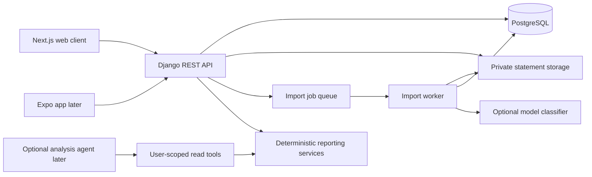

# Architecture

This repository is a foundation, not a deployed product. The Django app and
reporting prototype exist; the client, imports, workers, and AI integrations are
planned modules.

## System boundaries

Use one backend and database. Keep ingestion and reports in the same codebase
initially, with a separate process for long-running work. A modular monolith is
sufficient; separate services would add deployment work before the import flow
is proven. The worker imports the backend's services rather than duplicating
business rules.

The planned Next.js client uses TypeScript and the App Router; web UI is not
generated yet. Django 5.2 is a long-term-support branch that supports Python
3.12, the installed Python series. SQLite enables local scaffold checks;
PostgreSQL must be verified before multi-user release. [Django release notes](https://docs.djangoproject.com/en/5.2/releases/5.2/),
[Next.js installation](https://nextjs.org/docs/app/getting-started/installation).

## Ledger model

| Entity | Responsibility |
| --- | --- |
| User | Identity managed by Django authentication |
| Account | Owner, issuer, account kind, currency, display name |
| Statement | Account, source file metadata/hash, period, processing/review state |
| ImportedTransaction | Staged extraction, original row data, proposed fields, review state |
| Transaction | Normalized ledger entry, confirmed flag, source-row relationship |
| Category | Owner-specific category definitions |
| CategoryRule | Explicit owner-specific matching rule and destination category |
| ProcessingJob | Import stage, attempts, status, and bounded failure details |

Ledger records carry an owner relationship. Model validation detects common
ownership mismatches when `full_clean()` is called. Django model `save()` does
not automatically provide complete validation or authorization. Future APIs
must scope querysets by the authenticated user, verify nested foreign keys, and
exercise denial tests. The current health endpoint exposes no ledger records.

The models prepare provenance and review state. They do not yet implement
parsing, atomic confirmation, automatic job retries, or file access control.

## Money and dates

- Store positive integer `amount_minor` with currency and an explicit kind.
  Initial USD amounts use cents. Extend the currency exponent table before
  accepting other currencies with different minor-unit scales.
- Use a separate flow for debit/credit. Validate signs in issuer adapters and
  normalized records. A refund contributes negative spending even though its
  stored amount is positive.
- Monthly spending includes confirmed expenses minus confirmed refunds.
  Income, transfers, card payments, and unresolved adjustments are excluded.
- Group by posted date, preserving purchase date separately when available.
  Statement periods and calendar months are different concepts.
- Report each currency separately. Foreign-exchange conversion is later work
  and must record the rate, source, and date used.
- Report coverage against all selected accounts, including accounts with no
  transactions. Merge verified statement periods; transaction export dates
  alone do not prove complete coverage.

## Authentication and privacy

The initial web deployment should expose the web client and API behind one
origin. Use server-issued sessions with secure, HttpOnly cookies and CSRF
protection for the browser. The mobile phase can add its own scoped token flow.
Signup, login, password recovery, and these routes are not implemented yet.

Every file belongs to a user and an account. Keep uploads in private storage,
issue short-lived download access only after ownership checks, and keep raw
statement content out of application logs. Delete source files, staged data,
and any derived model-provider files according to explicit retention choices.
Protected source relationships require an ordered deletion service; deleting a
User instance alone is not a complete account-deletion workflow.
Provider processing is opt-in and uses only the required fields. The first
release also needs upload/job limits, request throttling, and deletion behavior.

## Where harness, RAG, and MCP fit

| Concept | Intended use here | Phase |
| --- | --- | --- |
| Coding-agent guidance | AGENTS.md and CLAUDE.md describe boundaries and checks for Codex/Claude Code | Now |
| Import processing workflow | Bounded stages, job state, retries, review, and validation | First usable release |
| Agent harness | Controls an optional analysis loop with user-scoped tools, step/cost limits, and traces | Later |
| RAG | Retrieve a user's approved historical classifications as examples for an unknown merchant | Later |
| MCP | Expose the same authorized reporting tools to compatible external AI clients | Later |

The import workflow is deterministic orchestration; it need not be an agent
loop. A later analysis agent may choose among tools such as
`get_monthly_spending`, `compare_spending`, and `list_supporting_transactions`.
Those tools return code-calculated facts. They cannot perform money transfers.

Classification order: explicit user rules, approved merchant matches, then an
optional model suggestion. Ambiguous merchants remain in review. Any retrieved
examples must be scoped to the current user before retrieval and generation.
Begin with database lookups; a vector database is optional and has no role in
financial arithmetic.

For a future OpenAI provider, Structured Outputs can constrain a category
suggestion to a JSON schema. Schema adherence does not prove that a category or
extracted amount is correct; validate semantics and handle refusals/incomplete
responses. [OpenAI Structured Outputs](https://developers.openai.com/api/docs/guides/structured-outputs).

MCP belongs at the edge as an adapter, with authentication and per-call scope
checks. It must reuse backend reporting and ownership logic rather than query
unrestricted user data. No model provider, retrieval index, agent runtime, or
MCP server is installed in this scaffold.
