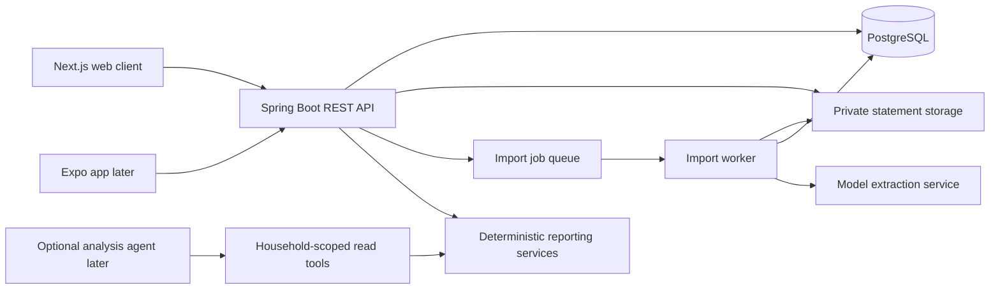

# Architecture

The backend target is now **Java with Spring Boot**, selected by the user on
2026-10-13. Next.js remains the web client. The Java backend is implemented at
`apps/backend`; the existing Django scaffold at `apps/api` remains a reference
with seven user-owned models, a health endpoint, and a Python reporting prototype.
The first Java slice includes Flyway, identity registration, authorized household
and account services, and public health. Browser authentication, data endpoints,
the client, imports, and AI remain pending. The legacy database remains intact.

## System boundaries

Use one backend and database. Keep ingestion and reports in the same codebase
initially, with a separate process for long-running work. A modular monolith is
sufficient; separate services would add deployment work before the import flow
is proven. The Java worker reuses backend application modules rather than
duplicating business rules. Python may support offline evaluation/training;
it does not become a second live ledger API.

Implementation follows [engineering conventions](engineering-conventions.md):
thin controllers, authorized application services, household-scoped query
services/repositories, pure calculations, and adapters for external integrations.
Use Spring Data JPA repositories for persistence. Next.js uses feature
modules; pure TypeScript formatters belong in `packages/shared`, with generated
API DTOs separately in `packages/contracts`.

The implementation baseline is Java 21, Spring Boot 4.1.1, and the checksum-pinned
Maven 3.10.0 Wrapper. Spring Boot manages compatible dependency versions.
Use Spring MVC, Spring Security, Spring Data JPA, Jakarta Bean Validation,
PostgreSQL, and Flyway. PostgreSQL integration tests use Testcontainers when
a container runtime is available; a disposable external PostgreSQL database is
also supported through TEST_DATABASE_* configuration.
[Spring Boot requirements](https://docs.spring.io/spring-boot/system-requirements.html),
[Spring Boot code structure](https://docs.spring.io/spring-boot/reference/using/structuring-your-code.html).

Flyway owns the Java schema; Hibernate validates it rather than creating or
updating it. Use PostgreSQL for local backend development and integration
checks; the legacy SQLite database is only for the Python reference.
[Spring Boot database initialization](https://docs.spring.io/spring-boot/how-to/data-initialization.html).

## Target household and ledger model

This remains a public, multi-user product. Each household has one shared ledger.
Private accounts, split expenses, and settle-up between members are later work.
Membership grants access; being a record's creator does not grant or restrict
access independently of membership.

| Entity | Responsibility |
| --- | --- |
| User | Application identity authenticated through Spring Security |
| Household | Shared ledger boundary |
| Membership | Unique user/household relationship and owner or member role |
| Account | Household, issuer, account kind, currency, display name |
| Statement | Household, account, private file metadata/hash, period, review state |
| ImportedTransaction | Household, staged extraction, original source data, proposed fields, review state |
| Transaction | Household, normalized ledger entry, confirmed flag, source-row relationship |
| Category | Household category definitions |
| CategoryRule | Explicit household matching rule and destination category |
| ProcessingJob | Household, statement, import stage, attempts, status, bounded failure details |

All ledger records, private files, jobs, rules, retrieval examples, and model
runs must belong to a household. An optional `created_by` user is audit data,
with nullable references that can be cleared on user offboarding. It is not the
authorization boundary and must not cascade-delete shared records.

| Role | Shared ledger reads and writes, imports and review | Membership/role management | Household deletion |
| --- | --- | --- | --- |
| Owner | Allowed | Allowed | Allowed |
| Member | Allowed | Own departure only | Denied |

A read-only viewer role is deferred. A household must retain an owner. Removing,
demoting, or allowing the last owner to leave requires transferring ownership or
deleting the household first. Serialize these operations with a household lock
inside the database transaction. Removing a member leaves shared records intact.

Create the Spring Boot schema with household ownership from its first Flyway
migration. This replaces the planned in-place Django household migration.
Keep the old database intact. If existing records need transfer, use a separate,
validated copy into the new schema: one household per legacy owner, no inferred
merges, with stable IDs or an explicit verified ID mapping and preserved amounts,
descriptions, hashes, and source relationships. Audit cross-owner links before
copying. See [backend transition](backend-transition.md) for the transfer policy.

Request DTOs use Bean Validation for shape/range checks; services enforce domain
rules for every caller, including jobs. For shared writes, acquire the household
lock inside a service transaction, then check current membership/role and every
related object's household. Database constraints provide additional protection.
Repository save/dirty checking does not itself authorize a write. Controllers,
workers, and adapters must not bypass application services through direct saves,
bulk JPQL, or arbitrary entity mutation. Cross-household denial tests are required
for services and every data endpoint. Query services authorize before scoped
reads and map results to DTOs; never expose JPA entities as API responses.

The legacy Django models prepare provenance and review state. Parsing, atomic
confirmation, automatic job retries, and file access control remain unimplemented.
Household/account services implement the initial authorization boundary; callers
must enter through these services rather than saving directly to repositories.

## Money and dates

- Store positive integer `amount_minor` with currency and an explicit kind.
  Initial USD amounts use cents. Extend the currency exponent table before
  accepting other currencies with different minor-unit scales.
- Java stored amounts use positive `long`/PostgreSQL `BIGINT` values. Use exact
  `BigInteger` report accumulation and deltas; any bounded `long` arithmetic
  must detect overflow. A port must preserve Python's exact calculation behavior.
- Planned normalized API money values use canonical decimal integer strings,
  such as `"1250"` cents, including report totals and signed deltas. Keep integer
  arithmetic on the backend; client formatting must preserve exactness.
- Use a separate flow for debit/credit. Validate signs in issuer adapters and
  normalized records. A refund contributes negative spending even though its
  stored amount is positive.
- Monthly spending includes confirmed expenses minus confirmed refunds.
  Income, transfers, card payments, and unresolved adjustments are excluded.
- Group by posted date, preserving purchase date separately when available.
  Statement periods and calendar months are different concepts.
- Calendar dates use `YYYY-MM-DD` and months use `YYYY-MM`; neither shifts with
  a viewer's time zone. Event timestamps are UTC ISO instants with `Z` and use
  explicit locale/time-zone settings for display. Use distinct shared formatters.
- Report each currency separately. Foreign-exchange conversion is later work
  and must record the rate, source, and date used.
- Report coverage against all selected accounts, including accounts with no
  transactions. Merge verified statement periods; transaction export dates
  alone do not prove complete coverage.

## Authentication and privacy

The initial web deployment should expose the web client and API behind one
origin. Use Spring Security server-issued sessions with secure, HttpOnly cookies
and CSRF protection for the browser. Configure an explicit JSON API login/error
flow; framework default login is not the finished account system. Do not disable
CSRF globally for cookie-authenticated writes. The mobile phase can add its own
scoped token flow. [Spring Security CSRF](https://docs.spring.io/spring-security/reference/servlet/exploits/csrf.html).
Custom login must persist its security context through Spring Security, apply
session-fixation protection, and refresh CSRF state; logout invalidates the
session. Verify these behaviors on real HTTP requests rather than assuming
that setting an authenticated principal alone establishes a browser session.
[Spring Security session management](https://docs.spring.io/spring-security/reference/servlet/authentication/session-management.html).
Signup, login, password recovery, and these routes are not implemented yet.

Every file will belong to a household and an account. Keep uploads in private
storage, issue short-lived download access only after membership checks, and
keep raw statement content out of application logs. Provider processing is
opt-in for the relevant household data and uses only the required fields. The
usable public release also needs upload/job limits and request throttling.

Use an explicit household deletion service with restrictive foreign keys and
JPA mappings that do not cascade-delete shared records unexpectedly. Lock the
household, authorize its current owner and stop further writes,
then remove transactions, staged rows and jobs, rules, statements, categories,
accounts, memberships, and the household in a database transaction. Do not
weaken foreign keys or enable broad JPA cascades without testing the full graph.
All shared mutation paths use the same household locking protocol; multi-household
operations acquire locks in stable ID order. Merely locking the deletion path
does not stop a worker that ignores that protocol.
Deletion tests must include all seven ledger models, rollback on failure, and
preservation of another household's data.

Private storage and provider-file deletion cannot participate in the database
transaction. Persist cleanup tasks/outbox records that survive household deletion,
then run cleanup after commit; record failures and retry them. Apply explicit retention
choices to original and derived files, and prevent in-flight workers from
recreating deleted data. User-account offboarding is a separate operation:
enforce last-owner rules, remove memberships, and clear optional audit user
references while preserving other members' shared ledger.

An offline CLI extraction evaluation can use synthetic documents before a full
signup, recovery, or web UI is built. That exception does not waive authentication
and household authorization for later network endpoints.

## Where harness, RAG, and MCP fit

| Concept | Intended use here | Phase |
| --- | --- | --- |
| Coding-agent guidance | AGENTS.md and CLAUDE.md describe boundaries and checks for Codex/Claude Code | Now |
| Extraction and evaluation | PDF extraction through a provider interface, deterministic CSV baseline, schema and semantic checks | First AI experiment |
| Import processing workflow | Bounded stages, job state, retries, review, and validation | Before a usable import flow |
| Agent harness | Controls an optional analysis loop with household-scoped tools and step/cost limits | Later |
| RAG | Retrieve a household's approved historical classifications as examples for an unknown merchant | Later |
| MCP | Expose the same authorized reporting tools to compatible external AI clients | Later |

Start PDF extraction with an OpenAI adapter; add Claude for comparison later.
Record evaluation metrics and privacy-safe traces from the first model call.
Keep one deterministic CSV parser as the baseline; receipt extraction is later.
No provider calls are introduced by this plan. The first experiment can define
the extraction contract and test it with synthetic inputs and a fake provider.
See [the next build task](next-move.md), [roadmap](roadmap.md), and
[AI technology guide](AI-Tech.md) for the experiment sequence and acceptance
criteria.

The import workflow is deterministic orchestration; it need not be an agent
loop. A later analysis agent may choose among tools such as
`get_monthly_spending`, `compare_spending`, and `list_supporting_transactions`.
Those tools return code-calculated facts. They cannot perform money transfers.

Classification order: explicit household rules, approved merchant matches, then an
optional model suggestion. Ambiguous merchants remain in review. Any retrieved
examples must be scoped to the authorized household before retrieval and generation.
Begin with database lookups; a vector database is optional and has no role in
financial arithmetic.

For the planned OpenAI provider, Structured Outputs can constrain an extraction
or suggestion to a JSON schema. Schema adherence does not prove that a category or
extracted amount is correct; validate semantics and handle refusals/incomplete
responses. [OpenAI Structured Outputs](https://developers.openai.com/api/docs/guides/structured-outputs).

MCP belongs at the edge as an adapter, with authentication and per-call scope
checks. It must reuse backend reporting and household authorization rather than query
unrestricted user data. No model provider, retrieval index, agent runtime, or
MCP server is installed in this scaffold.
