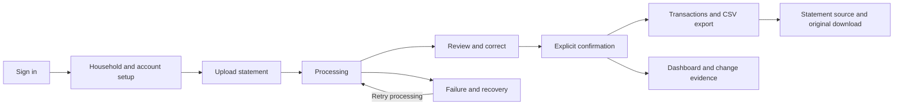

# Features first, then pages

Product planning draft, 2026-10-13. This proposes the first web experience for
the shared household tracker; it does not implement UI, APIs, or imports.
The user confirmed both original statement downloads and transaction CSV
exports. Other page placement and priorities below are recommendations for
discussion. Existing ownership, review, money, and reporting rules still apply.
Next.js remains the web client; the selected backend is Java Spring Boot. The
Python/Django scaffold and reporting prototype were removed on 2026-10-13.

## 1. Define the capabilities

A feature is something a user can accomplish. A page groups related features
around a task. One feature can appear on several pages, and one page can use
several feature modules.

| Feature group | User capabilities | Priority |
| --- | --- | --- |
| Access and household | Sign in/out; create/select a household; owner/member access; continue onboarding | Foundation |
| Bank/card accounts | Register issuer, account name/type and currency; distinguish multiple accounts at one bank | Foundation |
| Statement library | Browse files from all household accounts; search filenames; filter by issuer, account, period and import status | Core |
| Statement upload | Choose an account; upload PDF or supported CSV; review processing consent; see validation, progress and recoverable failures | Core |
| Import review | Compare source and extracted values; correct dates/amounts/kinds/categories; resolve duplicate candidates; exclude rows with a reason; confirm | Core |
| Confirmed transactions | Browse/search entries across banks; filter by posted dates, account, category, merchant and kind; inspect source; make explicit corrections | Core |
| Spending overview | Monthly net spending, category breakdown and comparison; select accounts/currency; show complete, partial or unknown coverage | Core |
| Spending-change evidence | Explain category/merchant contributions to the change between two completed months; open supporting transactions and source files | Signature feature |
| Download and export | Download an original uploaded file; export filtered confirmed transactions as CSV | Core; both confirmed by the user |
| Settings and administration | Manage categories, account labels, locale/time zone and household members; owner-only role management and household deletion; leave household safely | Core, delivered in stages |

Category editing is a core review capability. Advanced automatic category
suggestions, saved matching rules with previews, and retrospective rule changes
are separate later capabilities. Corrections do not implicitly create rules.

Self-service signup, password recovery and a verified invitation/join flow are
needed before an open public signup release. They can follow the first internal
authenticated import workflow; login alone is not a complete public access flow.
Household membership never comes from typing an arbitrary household ID.
Removing/demoting an owner or leaving cannot remove the household's last owner;
transfer ownership or use the authorized household deletion flow first.

## 2. Use a small page structure

Primary navigation: **Dashboard · Statements · Transactions · Settings**.
Show the active household in the application shell and an **Upload statement**
action on Dashboard and Statements. Show a household switcher when the user has
multiple memberships; every view is for one active household.

| Page or view | Features placed here | Main action |
| --- | --- | --- |
| Login and access screens | Sign in; signup, recovery and invitation screens as public access is completed | Sign in / accept invitation |
| Onboarding | Create or join an authorized household; register first account | Add first account, then upload |
| Dashboard | Monthly totals/categories; coverage; spending-change evidence; imports awaiting review | Inspect a change / resume review |
| Statements library | All-bank document list; filename search and filters; import status; original download | Upload / open a statement |
| Upload wizard | Account selection, PDF/CSV selection, processing consent, per-file errors and progress | Upload and continue to processing/review |
| Statement detail and review | One file's metadata, source, extraction issues, row corrections, duplicate decisions and confirmation | Review and confirm / download original |
| Transactions | Unified confirmed ledger; filters/search; explicit edits; source links; CSV export | Inspect an entry / export current selection |
| Settings | Account/category management; household members/roles; profile/display settings; leave/delete actions | Save settings / manage household |

Use tabs or sections inside Statement detail for **Overview**, **Review / imported
transactions**, and **Source**. A confirmed entry's detail can open as a drawer
from Transactions with a shareable internal link. Account and category forms
can initially live inside Settings and onboarding.

Upload is a short wizard with a direct URL, reached through an action rather
than a permanent navigation item. Export is a toolbar/menu action and a small
options dialog. Separate Upload, Exports, Reports, Accounts, and Categories
navigation pages can be added if their workflows later need that space.

### Suggested web routes

Public access routes are `/login`, `/signup`, `/forgot-password`, and the
recovery/invitation routes when implemented. Onboarding is `/onboarding`.
Signed-in content paths below are relative to `/h/{household_id}`:

| Path | View |
| --- | --- |
| `/dashboard` | Household overview |
| `/statements` | Statement library |
| `/statements/upload` | Upload wizard |
| `/statements/{statement_id}` | One statement and its review/source |
| `/transactions` | Confirmed ledger |
| `/transactions/{transaction_id}` | Entry detail or linked drawer |
| `/settings` | Account, category, household and personal settings |

These are proposed web routes, separate from the planned Spring Boot API paths.
A household ID in a URL identifies the scope; current membership still controls
access. Keep non-sensitive filters in query parameters so a refreshed or linked
view retains its selection; clear household-specific filters when switching.

## 3. Keep files, review rows and ledger entries distinct

**Statements library** answers: "Which files have we uploaded, and which need
attention?" Each row shows issuer/account, filename, verified period or unknown
period, upload date, processing/review state and unresolved issue count.
Its date filter refers to statement-period overlap; uploaded-at is a separate
filter/sort. Unknown periods remain visible and can be filtered explicitly.

**Statement detail** answers: "What did this file contain, and can I confirm
it?" Show the original description and source page/row beside normalized
fields. Every row must be accepted for inclusion or explicitly excluded with a
reason. Unresolved required fields or duplicate decisions on included rows
block confirmation; excluded invalid rows do not block the remaining import.
Show source reconciliation only when the file supplies suitable evidence.
Users can save review progress and return later without affecting spending.

**Transactions** answers: "Which confirmed entries are in our shared ledger?"
Its date filters use posted date. Show expenses, refunds, payments, transfers
and other kinds distinctly; payments can be visible here while excluded from
spending. A source link opens the relevant statement/page or CSV row.

User-facing import states are **Processing**, **Needs review**, **Confirmed**,
and **Failed**, with an uploaded/queued state where needed. These labels will
map to backend job/statement states during implementation. Upload success and
extraction success do not mean the ledger is confirmed.

A transient processing failure retries the existing statement. An unusable file
requires a corrected/supported upload. Reprocessing preserves saved corrections
and prediction versions; it cannot silently overwrite review or duplicate
confirmed entries.

Statement deletion must explain what happens to linked confirmed entries. The
service policy is still open; do not add a misleading delete button that leaves
reports or source links inconsistent. Editing reviewed labels also does not
silently rewrite confirmed entries; ledger corrections are explicit operations.

## 4. Specify the two export experiences

| Action | Entry point | Result |
| --- | --- | --- |
| Download original | Statement library row or Statement detail | The original PDF/CSV uploaded for that one statement |
| Export transactions | Transactions toolbar; optionally a statement's imported entries | A CSV of confirmed ledger entries matching the chosen filters |

For CSV export, show the account/date/category/kind/currency selection and
matching row count before downloading. Export all matching rows across
pagination, not just the visible page. A statement-specific export supplies
that statement filter and includes only its confirmed entries; disable it with
an explanation until confirmation.

Include posted date, account/issuer, original description, normalized merchant,
category, minor-unit amount, currency, flow/kind and available source IDs,
PDF page or CSV row references. Keep currencies explicit and money values exact.
Missing merchant or category values remain blank, not invented. The CSV is a ledger data export;
it does not recreate the bank's official PDF or export unreviewed predictions.
Bulk original-file ZIP downloads and formatted report PDFs can come later.
All downloads and export requests check current household access.

## 5. Make the signature feature visible

Place **"Why did my spending change?"** on Dashboard. Start with two completed
months and one currency, implementing [the reporting contract](reporting-contract.md)
in Java with synthetic acceptance cases.

Example: September spending is **$300 higher** than August. Dining contributes
**+$180**, groceries **+$90**, utilities **+$60**, and transport **-$30**.
Opening dining shows the supporting entries for both months; opening an entry
shows its statement source. Show selected accounts and coverage beside the
comparison. Partial/unknown coverage remains visible throughout the drilldown.

Current-month overview totals are labeled **so far**; the first spending-change
comparison uses completed months. Initial currency support is USD. Show a
currency selector when more currencies are implemented, and report each one
separately rather than combining their amounts.

This explains the amounts from evidence; it does not guess a person's motives.
AI narration can follow later, using the same code-calculated facts. A chat page
is not required for this feature.

## 6. Complete one user journey

Dashboard first-use state guides account setup and upload. A processing or failed
import remains visible in Statements, with an action to resume or retry safely;
file-validation failures return to upload with an explanation.
Saving an invalid/unresolved review never creates spending; repeated confirmation
never counts the same source row twice. Show missing verified account coverage,
including accounts that currently have no imported transactions.

## 7. Priority and implementation order

The Spring Boot foundation and authenticated household/account API exist.
Extend the ledger and build one complete upload -> processing -> review -> confirm workflow.
Add the Statements library
and unified Transactions view around it, then the populated Dashboard with
spending-change evidence. Include original download and CSV export in the usable
core release. Complete signup/recovery/join before open public signup.
This page plan follows the next [ledger and extraction task](next-move.md).
Household scope exists in the backend's first schema; any existing legacy data is preserved
under the [backend transition](backend-transition.md) policy.

After the core loop works, consider batch upload, explicit category rules with
match previews, recurring-charge candidates, and saved filters. Natural-language
search, spending chat, receipts, private accounts, settle-up, mobile, and live
bank connections remain later directions in [roadmap](roadmap.md).
Developer extraction comparisons, traces and evaluation metrics initially live
in development tools; user pages show actionable progress and review issues.

Pages compose feature modules rather than own business rules. Dashboard uses
reporting plus import-status features; Settings composes account, category,
household and profile features. Library/detail/upload belong to the statement
import workflow. Export begins inside the transaction feature. Follow
[engineering conventions](engineering-conventions.md) for module boundaries.

See [product scope](product.md), [import rules](imports.md), and
[planned API](api-plan.md) for the existing constraints behind this proposal.
