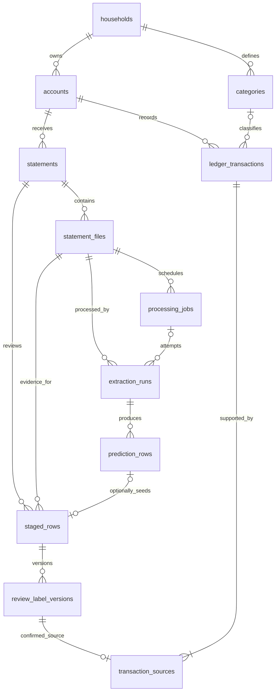

# Statement database design

Proposed on 2026-10-15. This is a provisional target for later Java/PostgreSQL slices;
no statement tables, migrations, native bank parsers, uploads, or ledger APIs exist yet.
It extends the existing household/account schema and the
[import workflow](imports.md), [architecture](architecture.md), and
[reporting contract](reporting-contract.md).

The immediate task is the standalone extraction/evaluation experiment in
[next move](next-move.md), using JSONL and no database. Exercise that contract
before adopting this schema; the eleven tables below are not an implementation
prerequisite and should change when observed extraction/review needs warrant it.

## Issuers and account types

Requested sources are Chase, Capital One, and Amex, covering credit-card and
bank/debit-card activity. Reuse the existing independent account fields:

| Field | Existing values | Meaning |
| --- | --- | --- |
| `accounts.issuer` | `CHASE`, `CAPITAL_ONE`, `AMEX`, `OTHER` | Institution |
| `accounts.kind` | `CREDIT_CARD`, `BANK_ACCOUNT` | Account whose movements are recorded |
| `accounts.currency` | `USD` initially | Supported normalized ledger currency |

Debit-card activity belongs to its bank account; do not create a separate
`DEBIT_CARD` ledger account or require a card record to import a bank statement.
Bank statements may also contain deposits, checks, transfers, and withdrawals.
Do not create issuer-specific transaction tables. Select an adapter by issuer,
account kind, file format, and verified layout/version. Product availability,
column names, amount signs, and date semantics require actual private samples;
this design does not claim every issuer/type combination has a supported export.
Only synthetic fixtures enter Git. Structured account metadata uses masked
identifiers only; original statement bytes remain private.

## Required entities and relationships

Reuse `app_users`, `households`, `memberships`, and `accounts`. Introduce the
following tables with the workflows that use them, rather than all at once.

| Proposed table | Responsibility | Introduce with |
| --- | --- | --- |
| `statements` | Logical account-scoped import, verified period, review/confirmation lifecycle | Statement metadata |
| `statement_files` | Immutable PDF/CSV source metadata and private storage identity | File intake |
| `extraction_runs` | One extraction attempt and its versioned execution metadata | Extraction |
| `prediction_rows` | Immutable source rows and nullable proposed values from a run | Extraction |
| `staged_rows` | Stable row identities selected for review, including manually added missing rows | Review |
| `review_label_versions` | Append-only reviewed values and decisions | Review |
| `ledger_transactions` | Confirmed financial entries used by reports | Confirmation |
| `transaction_sources` | Exact reviewed source revisions supporting ledger entries | Confirmation |
| `categories` | Household-owned category definitions; null means Uncategorized | Category editing/reporting |
| `processing_jobs` | Durable queue, attempts, leases, and cancellation | First asynchronous worker |
| `external_cleanup_tasks` | Durable private-storage/provider cleanup surviving parent deletion | First external storage/artifacts |



The diagram omits repeated scope/audit foreign keys. Cleanup tasks deliberately
have no foreign key requiring a deleted household, statement, or file to survive.

For this proposal, a statement can have explicitly attached PDF/CSV representations
of the same account and coverage. One file/run is selected as the review baseline;
other runs are comparisons, not additional transactions. Never group files merely
because account/date ranges match. Multi-account documents and concatenating
partial exports into a single statement are outside the first slice.

## Fields and authoritative values

Use UUID primary keys, `DATE`/Java `LocalDate` for calendar dates, and
`TIMESTAMPTZ`/Java `Instant` for events. Household-owned tables carry
`household_id`; the import/ledger chain also carries `account_id` and relevant
statement/file/run identifiers for scoped foreign keys. Audit actor references
are nullable, restrictive user foreign keys, cleared explicitly on user offboarding.
Member departure never deletes shared records.

### Statement and source files

| Table | Main fields and rules |
| --- | --- |
| `statements` | `id`, `household_id`, `account_id`, `state`, optimistic `version`, `statement_date?`, `period_start?`, `period_end?`, `coverage_status`, `coverage_basis?`, `coverage_source_file_id?`, `coverage_verified_by?`, `coverage_verified_at?`, `selected_file_id?`, `selected_run_id?`, `confirmed_by?`, `confirmed_at?`, `archived_at?`, `created_at`, `updated_at` |
| `statement_files` | `id`, household/account/statement scope, `original_filename`, generated `storage_key`, optional immutable object version, detected `format` (`PDF`/`CSV`), `byte_size`, `sha256`, optional `page_count`, `storage_state`, `uploaded_by?`, `created_at` |

Statement state is `DRAFT -> REVIEWING -> CONFIRMED`; extraction failures belong
to runs/jobs and can be retried without discarding the statement. Enter REVIEWING
when selecting a successful, complete baseline run and creating its staged rows
atomically. Do not replace that selection once review starts in the first slice.
Confirmed statements freeze the selection, coverage evidence, and source decisions.
Later extraction can produce comparison predictions only. Archiving changes
visibility; it does not remove confirmed spending or coverage evidence.

Period boundaries are both null or both present with `period_end >= period_start`.
`statement_date` is distinct from the coverage interval and transaction dates.
Coverage is `UNKNOWN`, `UNVERIFIED`, or `VERIFIED`; verified evidence includes the
inclusive interval, source file, verification basis, actor, and time. A successful
parse or the first/last transaction date does not verify coverage. Confirmation
can proceed with unknown coverage; reports remain partial/unknown as appropriate.
An explicitly verified empty statement can confirm with zero ledger entries.
Reports count coverage only from CONFIRMED statements with VERIFIED evidence,
including archived confirmed statements; uploads/review work cannot establish
complete ledger coverage before confirmation.

Private storage holds original bytes; the database stores metadata, never public
URLs or statement blobs. Filenames are display data, not storage paths. Upload
validation bounds size/pages and checks content independently of filename/MIME.
Reserve a unique immutable storage key before upload, finalize only after object
verification, and reclaim abandoned reservations through durable cleanup. Downloads
require current household access; private responses bypass shared caches.

### Extraction and review

| Table | Main fields and rules |
| --- | --- |
| `extraction_runs` | Scoped file reference, optional `job_id`, `attempt_no`, `method`, provider/model/parser/prompt/schema versions, `status`, start/end times, usage, optional cost estimate with pricing basis, bounded issue codes, versioned `document_observations` |
| `prediction_rows` | Scoped run/file reference, server `row_ordinal`, PDF page range or CSV record number, `raw_description`, raw date/amount/debit-credit/currency text, optional issuer transaction ID, nullable normalized proposals, bounded validation issues |
| `staged_rows` | Scoped statement/file reference, nullable originating run/prediction, immutable manual source description/raw date/amount text and page/record locator when no prediction exists, optimistic `version`, `created_at` |
| `review_label_versions` | Scoped staged-row reference, `revision_no`, full typed reviewed snapshot, `decision`, optional duplicate target ledger ID, `verified_against_source`, reviewer/time/reason |

Each retry creates a new run; terminal run results and predictions are immutable.
Source references use PDF pages or parsed CSV record ordinals, not physical line
numbers that break on quoted newlines. Preserve raw source descriptions separately
from any reviewed display text or normalized merchant. A source row's original
issuer ID and raw values remain evidence, never tenant selection or authorization.

Normalized proposals/review snapshots contain `posted_date`, optional
`purchase_date`, `amount_minor`, `currency`, `flow`, `kind`, optional merchant and
category. Unknown required values remain null. A manually added missing row has
no invented model prediction and must identify its source file/page/record and
preserve the available raw values separately from reviewed values.

The latest review revision is the authoritative reviewed snapshot; staged rows do
not maintain a second editable copy. Before a review exists, the UI may display
the immutable prediction as a proposal. Decisions are `UNDECIDED`, `CREATE_ENTRY`,
`LINK_EXISTING`, or `EXCLUDE`. Draft reviews may be incomplete; confirmation blocks
UNDECIDED rows and requires valid normalized fields for CREATE_ENTRY/LINK_EXISTING.
EXCLUDE requires a reason. LINK_EXISTING requires the same household/account,
posted date, amount, currency, flow, and kind as the ledger target. A mismatch
requires correction/review, not a forced merge; a fingerprint alone is insufficient.

Each human edit appends a revision and advances row/statement versions in one
authorized transaction. Acceptance and source verification are separate facts;
acceptance alone is not evaluation ground truth. Confirmation binds the exact
revision, so a later label correction never silently rewrites the ledger.
Changing categories creates no rule unless the user explicitly requests one.

### Confirmed ledger and provenance

| Table | Main fields and rules |
| --- | --- |
| `ledger_transactions` | `id`, household/account scope, `posted_date`, `purchase_date?`, positive `amount_minor BIGINT`, `currency`, `flow`, `kind`, preserved original description, optional reviewed description/normalized merchant/category, confirmation actor/time |
| `transaction_sources` | `id`, household/account/statement scope, `ledger_transaction_id`, `staged_row_id`, exact `review_revision_no`, relationship (`CREATED`/`DUPLICATE_EVIDENCE`), `created_at` |
| `categories` | `id`, `household_id`, `name`, `archived_at?`, audit times; category removal cannot erase historical source/review references |

The ledger contains confirmed entries only; pending rows stay in staging, so it
needs no independently mutable `confirmed` flag. Every imported ledger entry has
at least one source, created in the same confirmation transaction. Multiple files
or overlapping statements may support one entry after explicit duplicate review.
Each staged row supports at most one ledger entry across all its label revisions.

Transaction amounts are positive bounded Java `Long`/PostgreSQL `BIGINT` values;
staged proposals may be null. Normalized currency is explicitly USD initially,
without silently defaulting unresolved or foreign source values. Validate input
length/range at both HTTP and application boundaries. Use canonical integer-string
money DTOs, checked bounded arithmetic, and `BigInteger` report totals/deltas.

`flow` is normalized `DEBIT` or `CREDIT` using account-holder statement semantics:
a debit reduces a bank balance or increases card debt; a credit does the reverse.
Keep this separate from economic `kind`:

| Example | Account kind | Flow | Kind | Spending effect |
| --- | --- | --- | --- | --- |
| Card purchase | CREDIT_CARD | DEBIT | EXPENSE | Add amount |
| Debit-card purchase | BANK_ACCOUNT | DEBIT | EXPENSE | Add amount |
| Purchase refund | Either | CREDIT | REFUND | Subtract in posted month |
| Salary deposit | BANK_ACCOUNT | CREDIT | INCOME | Excluded |
| Credit-card payment, bank side | BANK_ACCOUNT | DEBIT | CARD_PAYMENT | Excluded |
| Same payment, card side | CREDIT_CARD | CREDIT | CARD_PAYMENT | Excluded |
| Account transfer | Either | Either, with verified mapping | TRANSFER | Excluded |
| Unresolved adjustment | Either | Either, if known | ADJUSTMENT | Excluded |

Adapters must verify these mappings for the actual layout; a printed minus sign
or a credit alone does not establish the kind. Cash withdrawals need an explicit
classification policy; do not automatically count them as purchases. Linking two
sides of a payment/transfer is later work; equal amounts are not proof. Preserve
both account entries and exclude both payment sides from spending.

### Statement balances and reconciliation evidence

`extraction_runs.document_observations` holds versioned, untrusted document-level
proposals with raw values and page/record evidence: period, statement date,
opening/closing balances, stated totals, and optional credit-card due date/minimum
payment. Use bounded schema-validated JSONB for variable source observations;
normalized financial/review fields stay typed columns. Never confuse available
balance, current balance, statement closing balance, or minimum payment.

When reconciliation is implemented, add typed reviewed statement metadata:
`opening_balance_minor`, `opening_balance_date`, `closing_balance_minor`,
`closing_balance_date`, `balance_currency`, `balance_basis` (`ASSET`/`AMOUNT_OWED`),
and evidence/reviewer/time references. Balances may be zero or negative and need
their own signed bounds; positive-transaction constraints do not apply.
For verified matching boundaries/conventions, bank closing balance is opening
plus credits minus debits; card amount owed is opening plus debits minus credits.
Reconcile all movements with exact integer sums, including payments and transfers.
Missing/ambiguous totals mean reconciliation is unavailable, not passed. A persisted
check must identify the exact run/review versions and become stale after edits.
Reconciliation success does not prove complete coverage or row-level correctness.

## Constraints, indexes, and confirmation

Add scoped unique keys in a new Flyway migration; do not edit applied V1-V5.
Composite foreign keys must enforce the complete parent scope, including a
statement/file/run when relevant. For example:

```text
accounts:   UNIQUE (household_id, id)
statements: UNIQUE (household_id, account_id, id)
statement_files:
  FOREIGN KEY (household_id, account_id, statement_id)
    REFERENCES statements (household_id, account_id, id) ON DELETE RESTRICT
  UNIQUE (household_id, account_id, statement_id, id)
  UNIQUE (household_id, account_id, sha256)
```

Apply the same scoped-key pattern through runs, predictions, stages, labels, and
sources. A selected run must belong to the selected file and statement. Nullable
composite references need explicit all-or-none checks for their optional identity
parts; MATCH SIMPLE alone can skip a partially null reference. Category references
include household; duplicate/source ledger references include household and account.
These constraints supplement current membership checks, not replace them.

| Constraint/index | Purpose |
| --- | --- |
| File hash unique within household/account | Exact re-upload returns the existing authorized import; no global existence oracle |
| `UNIQUE(run_id, row_ordinal)` | One immutable source row identity per execution |
| Unique non-null prediction origin on staged rows | A baseline prediction cannot seed two review identities |
| `UNIQUE(staged_row_id, revision_no)` | Append-only ordered review history |
| `UNIQUE(staged_row_id)` on transaction sources | One confirmed mapping across all revisions of a staged row |
| Statement `(household_id, account_id, created_at, id)` | Scoped import list |
| Ledger `(household_id, account_id, posted_date, id)` | Selected-account report/drill-down |
| File/run, statement/stage, row/revision and ledger/source reference indexes | Source navigation, review, restrictive deletion checks |
| Nonunique account/date/amount/merchant fingerprint | Duplicate candidates only; never an automatic merge |

No unique account/month/period constraint: statement cycles and exports overlap.
Reliable issuer transaction IDs remain evidence until their account-scoped
stability is verified. Row-local CHECK constraints cover bounds, enum values,
period order, and required fields by decision. Cross-row authorization,
immutability, source completeness, and lifecycle rules belong in application
services and PostgreSQL integration checks. PostgreSQL does not automatically
index referencing foreign-key columns; add indexes for actual query/deletion paths.
[PostgreSQL constraint guidance](https://www.postgresql.org/docs/16/ddl-constraints.html).

Confirmation is one application-service transaction:

1. Lock the household, check current enabled actor membership/role, then lock
   the statement. Require the expected statement/row versions and current scope.
2. Verify the frozen baseline, every row's latest decision/required fields,
   categories, source references, and any duplicate target. Every row needs a
   resolved decision; incomplete fields on explicitly excluded rows do not block
   valid included rows.
3. Create accepted ledger entries or link reviewed duplicates, then insert exact
   revision source mappings. Never delete a candidate solely for its fingerprint.
4. Mark the statement CONFIRMED with the selected run and audit time; commit
   everything together. A failure rolls back all entries, sources, and state.

Repeated confirmation returns the existing confirmed result. Source uniqueness
alone cannot prevent duplicates from another extraction run; the statement's
frozen selection and terminal confirmation state are also required. Post-confirm
ledger correction/replacement needs a separate explicit audited workflow.

## Jobs, cleanup, and implementation order

When asynchronous work starts, `processing_jobs` needs household/account/file
scope, initiating actor, processing consent/limits, stage/status, `available_at`,
attempt count/max, `lease_token`, `lease_expires_at`, cancellation, and bounded
error codes. Index runnable status/time. Claim with the household lock before
job locks; every claim/reclaim gets a fresh lease token bound to its attempt/run.
Commit the lease, then call providers outside database transactions.
Publication reacquires household/job locks and checks current actor membership,
consent, statement state, and the exact attempt/run and unexpired lease token.
Revoked actors, expired
attempts, canceled jobs, or deleted households cannot publish. Queue retries create
new run attempts, not replacement predictions or silently duplicated ledger rows.

`external_cleanup_tasks` stores an opaque immutable storage/provider resource
identity/version, task state, attempts, next retry time, and bounded failure code.
An optional household UUID is audit context, not a live FK or authorization token.
Persist cleanup intent before removing references; execute it after commit.
Track pending uploads/provider artifacts so a worker finishing after deletion
still leaves a durable cleanup obligation. Never reuse keys that a queued cleanup
could later delete. Ordinary traces contain IDs, versions, usage, timing, and codes;
raw prompts/outputs require separate private opt-in retention and cleanup.

Use restrictive foreign keys and explicit deletion, without JPA cascade removal
or orphan deletion. Initially archive confirmed statements and reject destructive
deletion that would discard ledger provenance. For unconfirmed/full-household
deletion, clear selection pointers, remove children in tested dependency order,
and enqueue external cleanup in the same transaction. Member removal preserves
the graph. Do not ship deletion until full-graph rollback/isolation tests pass.

Suggested implementation slices:

1. Run the standalone Java CSV/PDF contract and scorer with JSONL artifacts;
   inspect results and refine this provisional design before database work.
2. Statement/file metadata and scoped account keys, then persisted extraction
   runs/predictions; cleanup with actual storage and jobs with real async work.
3. Staged review and immutable revisions, then atomic ledger/source confirmation;
   add categories when category editing/reporting consumes them.
4. Reporting and coverage acceptance cases; reviewed balance checks and explicit
   correction/deletion workflows when their full graph is supported.

For those slices, PostgreSQL tests must cover same-household success,
foreign/revoked access denial, same-household wrong-account/statement substitution,
exact re-upload races, repeated/concurrent confirmation, rollback, rerun isolation,
two legitimate identical purchases, explicit duplicate links, empty verified
statements, missing coverage, exact/overflow-safe money, and worker lease/revocation
races. Keep all representations of one synthetic statement in the same dataset
split; immutable predictions and accepted/source-verified labels stay distinct.

Before parser implementation, choose the first privately inspected issuer/type/
layout and its date/sign conventions. Before correction or destructive deletion
ships, specify how ledger history, multiple sources, and coverage are preserved.
Category rules, merchant masters, card inventories, transfer matching, monthly
summary tables, and a database dataset registry are later needs, not prerequisites
for the first statement slice.
